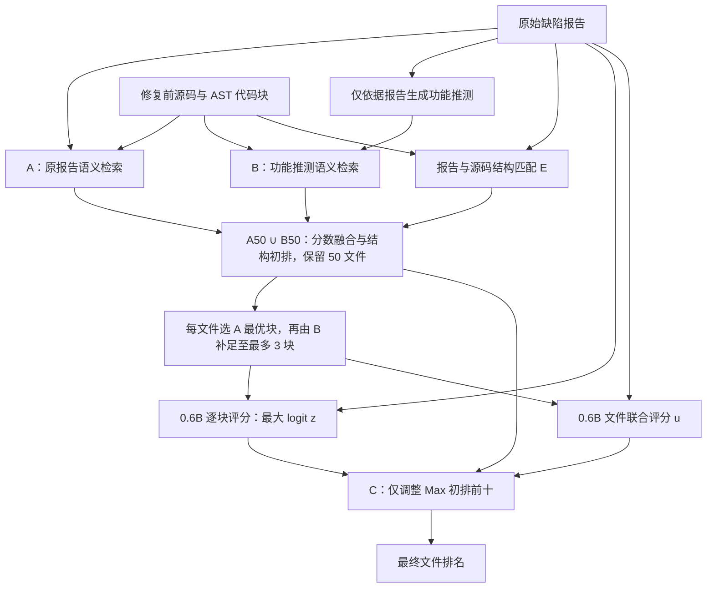

# A+B+C：当前文件级缺陷定位方法

项目主线由原报告语义检索 A、功能推测语义检索 B 和代码证据重排 C 组成。本页作为首页、论文说明与实验入口的共同方法定义；各次实验的冻结输入、实现哈希和成绩仍以对应协议为准。

## 输入、输出与流程

输入是缺陷报告正文与对应的修复前源码快照，输出是最多 50 个候选文件的排名。修复文件标签用于评价或预先划定的开发集选参，不进入推测生成、结构特征和重排输入。



BM25 是词面对照，历史 BM25＋AST RRF 见[旧融合实验](hybrid-retrieval.md)。它不参与本页 A/B 两路的主线定义。

## A 与 B：互补语义检索

A 使用原报告正文，B 使用仅由报告生成的功能描述。生成阶段不读取仓库目录、源码或修复补丁；两路随后检索同一修复前代码表示。基础表示采用 Qwen3-Embedding-0.6B 与 AST64，代码块初始预算 1,500 字符、结构前缀最多 64 tokens，总编码预算 512 tokens。细节见[语义检索](semantic-retrieval.md)。

功能推测提供另一条候选与选块信号，其文本不直接加入 C 的报告查询。历史报告增强、直接功能推测和模型设置须按[功能推测实验](report-hypothesis-crossproject180.md)及各次冻结协议区分。

## A+B：候选合并与结构初排

取 A Top50 与 B Top50 的去重并集，按下面的初排分数保留最多 50 个文件：

```text
N(s) = clip((s - s50) / (s1 - s50), 0, 1)
p(f) = α N(A(f)) + (1 - α) N(B(f)) + γ E(f)
参照参数：α = 0.5，γ = 0.5
```

不足 50 个文件时使用末位分数作为归一化下界；全同分时归一化结果为零。`E` 衡量报告中的名称、路径与修复前源码声明的匹配，在候选并集内计算 IDF。初排同分时依次使用 B 名次、A 名次与文件路径。

结构实现有两个需要明确区分的版本：

| 版本 | 用途与结果边界 |
| --- | --- |
| `ab_structure_v1` | 已登记的初排版本，使用原 Python 轻量声明扫描；2,294 条初排和 2026-11-23 完整 500 条组合采用此版本 |
| `structure_ast_v2` | 基于 Tree-sitter 的多语言结构特征；2026-11-24—25 GHRB/SWE 系数实验采用此版本，不能直接套用旧版成绩 |

初排注册与校验见 [current-baseline.md](current-baseline.md)，新版结构定义见[多语言结构匹配](multilingual-structural-matching.md)。

## C：联合代码证据与初排先验

对每个候选文件，先选 A 最相关的代码块，再按 B 的块排名去重补足到最多 3 块。使用原报告在既有语义编码预算内可见的文本作为 C 查询。

1. 使用 Qwen3-Reranker-0.6B 分别对报告—代码块评分，取最大 logit `z(f)`，得到 50 个文件的 Max C 初排。
2. 将同文件的已选块按冻结顺序组成联合文档，用同一模型得到文件级 logit `u(f)`。联合输入上限为 4,096 tokens，批次为 8。
3. 对 **Max C 初排前十**计算组合分数并排序，第十一名及之后保持原顺序：

```text
s(f) = (1 - β) z(f) + β u(f) + λ p(f)
参照参数：β = 0.25，λ = 4
即：s(f) = 0.75 z(f) + 0.25 u(f) + 4 p(f)
```

这里的前十是 Max C 的前十，不是 A+B 初排的前十。联合文档不包含标签、补丁、功能推测或检索分数；`p` 在模型外参与组合。C 同分沿用进入该阶段前的次序，具体实现与校验见[完整组合实验](ab-structure-newc500.md)。

最后一步保持前十集合，因此不会相对同一 Max C 排名改变 Top10 命中率，但会改变 Top1、MRR 和 MAP。它不能保证每条报告都改善。直接 8B、0.6B→8B、Agent、LoRA 和调整全部 50 个文件属于独立对照或扩展，不与本参照流程混报。

## 已有证据

| 范围 | 方案 | MAP@10 | 解释 |
| --- | --- | ---: | --- |
| SWE 全量 2,294 条 | `ab_structure_v1` 初排 | 0.621854 | 只评价 A+B，含开发数据 |
| SWE 固定 500 条 | 新 AB＋原 Max C | 0.648499 | 相同新候选的 C 对照 |
| SWE 固定 500 条 | 新 AB＋联合证据/初排先验 C | 0.691051 | 完整 A+B+C；Top1 66.0%、Top10 93.2% |
| GHRB 项目验证 78 条 | 多语言结构＋参照系数 | 0.550241 | 新结构版本下的跨数据集参照 |
| SWE 项目验证 279 条 | 多语言结构＋参照系数 | 0.693319 | 同次系数实验的历史 SWE 项目留出 |

完整 500 条中 499 条成功、1 条既有失败计零。相对旧池＋新版 C，换用新 AB 候选仅增加 0.000879 MAP，未显著；不能把全部收益归因于候选更换。详见[完整组合](ab-structure-newc500.md)与[机制分析](c-evidence-prior500-mechanism.md)。

多数据集系数验证未找到跨 GHRB/SWE 一致更优的统一系数；参照中的 `λ=4` 有历史依据，但不是已证明的最优值。新结构版本、验证集和评分来源与历史 500 条不同，不能跨表拼接成绩。选择规则、统计区间和限制见[最新结论](multidata-coefficient-results-20261125.md)。

## 运行与复现

所有命令从项目根目录运行。仓库包含实现、配置、冻结样本清单与说明；数据、模型和原始评分位于本地资产目录，需要另行准备。

| 阶段/任务 | 代码或协议入口 | 输入前提 |
| --- | --- | --- |
| A 原报告检索 | `scripts/retrieval/run_vector_batch.py` | 本地数据、修复前源码、Embedding 模型与 ES；默认基础对照范围不等于完整 500 条 |
| B 功能推测与检索 | `scripts/experiments/run_direct_hypothesis.py`；[流程](direct-report-hypothesis.md) | 报告生成模型服务、共享检索配置与对应样本清单 |
| A+B 固定初排重放 | `scripts/retrieval/run_current_baseline.py`；[注册说明](current-baseline.md) | 已审计的 A/B 排名和结构特征；不执行 C |
| 新 AB＋Max C 配对评分 | `scripts/experiments/run_ab_structure_c500.py`；[协议](ab-structure-c500.md) | 冻结 500 条、已保存 A/B 检索结果、初排研究产物和 Reranker |
| 新 AB＋新版 C 完整组合 | `scripts/experiments/run_ab_structure_newc500.py`；[配置](../configs/experiments/ab_structure_newc500.json) | 上一步的配对 Max 分数、旧联合评分及其独立审计产物；校验后复用并补齐新文件评分 |
| 多数据集结构与系数验证 | `scripts/experiments/run_multidata_coefficients.py`；[协议](multidata-coefficient-experiment-20261124.md) | GHRB/SWE 数据、源码、A/B 排名和对应阶段模型 |

先检查已登记的 A+B 子阶段和完整组合入口：

```bash
python scripts/retrieval/run_current_baseline.py --check-only
python scripts/experiments/run_ab_structure_newc500.py --help
```

这些命令分别校验版本、显示参数，不代表已运行完整 A+B+C。现有完整 500 条入口是基于冻结产物的分阶段复现，不能描述为首次克隆后即可一键端到端运行。服务准备与基础检索环境见[操作指南](reproduction-requests44.md)，该指南中的 BM25/分块成绩仅作历史对照。
