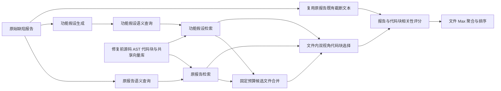

# 历史 C3 论文详细大纲

本页归档早期 B40＋A 补足、Max C3 方案的论文草稿。“当前”“待补”等词以当时实验阶段为准；现行论文组织见[论文大纲](paper-outline.md)，方法定义见 [A+B+C](main-method.md)。

更新日期：2026 年 11 月 12 日。本文按方法型研究论文组织，重点展开创新点、方法定义、已有实验的位置和后续实验。当前版本对应未进行本任务微调的 C3 流程；重排器微调作为计划扩展单列。

建议题目：**面向文件级缺陷定位的双路语义检索与证据协同重排**。

英文工作标题：**Dual-View Semantic Retrieval and Evidence-Aware Reranking for File-Level Bug Localization**。

中心论点：缺陷报告和由其推断的功能假设提供不同的检索线索。将两者保留为独立语义查询，在候选文件和文件内代码证据两个层面进行组合，再基于原始报告重排，有望在有限证据预算下改善文件定位。现有实验支持进一步研究这一设计，最终贡献强度由公平对照、独立验证和统计分析确定。

状态标记：**已有**表示已有实现和实验产物；**待分析**表示已有结果需要整理或统计；**待实验**表示需要新增受控实验；**计划扩展**表示尚未实现或评估的方法。

## 1 创新点的定位与写法

### 1.1 双路语义合并可以作为具体方法贡献

当前设计应明确命名为“原报告与功能假设的双路语义检索”。两个视角共用同一个编码器和代码向量库，不是 BM25 与向量检索的混合，也不是两个不同编码模型的集成。

具体设计包括：

1. 保留原始报告作为独立语义查询，保留标识符、错误信息和行为描述等直接线索。
2. 从报告生成功能及内部逻辑假设，作为第二个独立语义查询。
3. 两路分别产生文件和代码块排名，在固定文件预算下合并候选。
4. 在每个候选文件内部，再结合两路排名选择有限数量的代码证据。
5. 用原始报告对实际代码块评分，并聚合为文件排名。

可以提出这套具体方法并论证其价值。已有一般性的双路检索先例，不能直接否定上述特定设计的贡献；当前文献核查也不能证明“首次双路语义合并”。论文应首先写清机制、差异和证据，是否使用“首次”留待系统性相关工作核查。

### 1.2 最接近工作的具体差异

| 工作 | 查询与检索特点 | 与当前方法的主要差异 |
| --- | --- | --- |
| [HyDE](https://aclanthology.org/2023.acl-long.99/) | 生成假想相关文档，编码后检索；论文也讨论融合原查询向量 | 当前保留两条独立排名，在文件候选与文件内代码块层面组合，不是只融合查询向量 |
| [CosFL](https://arxiv.org/html/2411.17230v1) | 将故障定位转为功能描述生成与多粒度语义代码检索 | 当前生成阶段仅接收缺陷报告，保留原报告独立检索，并加入有限代码证据选择与独立重排器 |
| [BLAgent](https://arxiv.org/html/2605.17965v2) | 将报告转成结构和行为两类查询，双路 dense 检索、合并候选，再进行代理重排 | 当前查询组合是原报告与功能假设；候选配额、原文 Top-1 加推测补足的选块规则、逐块判别评分与文件 Max 聚合均有具体差异 |
| [Reformulate Retrieve Localize](https://arxiv.org/html/2512.07022v1) | 提炼摘要、标识符等信息，经 BM25 检索后由代理检查文件 | 检索表示、双路独立候选生成和证据选择流程不同 |

这些差异用于界定方法，不意味着已经证明优于完整已有系统。仓库中的 BLAgent 风格 AST 分块适配不能作为完整 BLAgent 对照，BLAZE 分块参考也不能作为完整 BLAZE 系统结果。

另有 [Generative Query Expansion for Bug Localization via Local LLMs](https://ssrn.com/abstract=6771695) 需要补读全文。目前仅核实摘要，不据此判断其与本方法是否重复。

### 1.3 创新点一 原报告与功能假设的互补语义召回

**问题。** 原报告可能描述症状而缺少实现功能语义；功能假设补充实现线索，但可能遗漏原文标识符或产生偏移。

**设计。** 两路分别检索，以确定性候选配额和去重补足构建共享候选池。当前实例保留功能假设 Top-40，再按原报告排名补足至 50 个不同文件。

**建议贡献表述。**

> 本文提出面向文件级缺陷定位的原报告与功能假设双路语义召回方法，分别保留报告中的直接线索与推断的实现功能线索，并在固定候选预算内组合两路候选，为后续定位提供补充信息。

**已有。** 原报告、功能假设单路检索以及 C/D 两种合并方向有结果；C/D 保存候选召回、命中和补充挽回统计。

**待补。** 原文 50、推测 50、混合 50 的等预算对照；两路独有正确候选；与摘要、查询拼接、向量融合、RRF 的比较。

**边界。** C/D 的 500 条 MAP 仅相差约 0.000116，尚不能说“推测优先”明显更好。40/10 是当前参数，不是已经证明的最优分配。

### 1.4 创新点二 固定证据预算下的双视角代码块选择

**问题。** 找到正确文件后，重排器仍只能看到少量代码块；文件被召回不意味着有判别力的实现片段被选中。

**设计。** 固定候选文件后，先选原报告最相关的一块，再按功能假设相似度去重补足至最多三块。

**建议贡献表述。**

> 本文设计双视角代码证据选择策略，在每个候选文件内保留原报告最相关代码块，并以功能假设检索到的代码块补充证据，使有限重排预算同时覆盖两类线索。

**已有。** C1/C2/C3 固定候选池与重排查询，仅改变代码块选择。C3 的 MAP 在全部 500 条和新增 320 条中均高于 C1/C2，是当前最直接的组件证据。

**待补。** 增益置信区间、共同和独有块分析、原文候选池下的混合选块、块数和分配比例，以及成功和退化案例。

**边界。** “抑制幻觉”“保留因果证据”是待检验的解释。当前支持平均排序改善，不支持所有报告、项目和指标都改善。

### 1.5 重排与微调如何列为贡献

当前重排器使用已有 Qwen3-Reranker-0.6B 权重推理。接入现成重排器是系统组成部分，不宜单列为新的算法贡献。

当前稿可列三项贡献：

1. 原报告与功能假设双路语义召回框架。
2. 固定代码块预算下的双视角证据选择方法。
3. 对候选覆盖、证据选择和排序收益的受控实证研究及可复核产物。

若后续微调解决明确训练问题，例如文件级弱标签如何监督代码块重排、如何利用双路检索产生的困难负例，可把“面向双路候选分布的重排训练”发展为第三项方法贡献。仅使用 LoRA 或常规微调工具不自动构成独立创新。

## 2 论文正文的章节安排

| 正文章节 | 要回答的问题 | 重点材料 |
| --- | --- | --- |
| 摘要 | 解决什么问题，用什么方法，获得什么结果 | 最终主结果和贡献概括，最后写 |
| 第 1 章 引言 | 为什么报告、功能假设和有限代码证据值得研究 | 真实动机案例、研究缺口、贡献 |
| 第 2 章 背景与相关工作 | 与查询改写、功能检索、双路检索和重排有何关系 | 方法差异矩阵与正式引用 |
| 第 3 章 问题定义 | 输入、输出、可用信息和评价目标是什么 | 文件排名、修复前快照、标签 |
| 第 4 章 方法 | 各阶段如何协作，哪些设计可被消融 | 第 3 节的形式化、流程图与算法 |
| 第 5 章 实验设计 | 如何做到公平、可复现和独立评价 | 数据、基线、预算、划分、统计 |
| 第 6 章 实验结果 | 整体效果和组件贡献分别是什么 | 第 5 节的 RQ 和结果表 |
| 第 7 章 讨论与有效性威胁 | 何时失效，结论能推广到哪里 | 退化、标签噪声、截断、泄漏、成本 |
| 第 8 章 结论 | 哪些问题已经得到回答 | 仅概括最终证据支持的结论 |

篇幅有限时可合并第 3、4 章，把相关工作放在讨论之后，不改变方法与实验对应关系。

### 2.1 摘要五句骨架

1. 文件级定位需要将自然语言缺陷描述映射到实现代码，但语义差异影响检索。
2. 功能假设提供额外线索，有限重排预算使候选文件和代码证据选择成为关键问题。
3. 提出原报告与功能假设双路语义检索，在候选层和代码块层组合信息，并以原报告驱动重排。
4. 在明确数据范围、基线和协议下报告效果、组件贡献与成本。
5. 概括得到支持的互补性结论和适用范围。

第 4 句最终数字应来自冻结方案后的正式评价。当前 500 条可写成开发分析实验，不能改称最终独立测试。未完成微调前，摘要不写训练收益。

### 2.2 引言六段结构

- 第一段：文件级定位的作用，明确本文输出文件排名。
- 第二段：报告可能只描述症状或包含冗长日志，直接检索可能遗漏实现功能线索。
- 第三段：功能推测可补充语义，但可能偏离实现，引出保留原报告独立路径。
- 第四段：正确文件被召回后，有限块预算仍可能遗漏关键片段，引出证据选择。
- 第五段：介绍双路候选、双视角选块和原报告重排。
- 第六段：列出贡献与结果，区分方法设计和实证发现。

动机案例从 C3 的真实逐报告结果中选取，展示原文、假设、两路正确文件排名、选中代码块和最终排名。不要用编造案例替代实验案例，也不要只展示获胜样本。

### 2.3 问题定义

给定报告正文 \(r\) 和源码快照 \(R\)，从文件集合 \(F(R)\) 中检索候选集 \(P_r\)，输出其排序 \(\pi_r\)，以该列表前 \(k\) 项评价。当前 C3 保存最多 50 个候选文件的重排列表，不追加候选外文件。标签 \(Y_r\) 是数据集标注的修复文件，只参与评价；微调中也只能使用训练集标签。

当前 SWE 格式化数据采用逐缺陷修复前提交和报告正文，不使用可能来自修复 PR 的独立标题。修复文件是定位的代理标签，不等于所有修改位置都是真正根因。

两层预算：候选数 \(K=50\)，每文件块数 \(m=3\)，最多约 \(Km=150\) 个报告与代码块评分对。相同块数不保证相同 token 数，成本实验应记录实际输入量。

## 3 方法章节重点展开

### 3.1 整体流程

功能假设只影响当前候选和证据选择，其生成文本不直接送入重排器。整个系统使用源码，但假设生成阶段不读取源码或仓库目录。

### 3.2 代码表示与共享索引

对修复前快照中的文件 \(f\)，分成代码块集合 \(C_f\)，附加结构前缀并编码：

\[
v_c=E_C(c),\qquad c\in C_f.
\]

当前为 Qwen3-Embedding-0.6B、AST64、初始 1500 字符预算、最多 64 tokens 结构前缀，前缀与代码共同受 512-token 预算约束。超长节点存在后续拆分，不能写成任何块都完整保留 AST 节点。

本节用于解释检索基础和复现设置。AST 是既有方案适配，不列为创新。两路共用代码块、代码向量和候选文件。

实现：[AST 分块](../src/bug_localization/ast_chunking.py)、[编码器](../src/bug_localization/embeddings.py)。

### 3.3 功能假设生成

定义：

\[
h=G(r)=h_{\mathrm{context}}\oplus h_{\mathrm{functionality}}\oplus h_{\mathrm{logic}}.
\]

context 描述可能的功能组件和职责；functionality 描述要寻找的操作、输入输出及条件；logic 描述数据处理、分支、状态变化或组件交互。

JSON 还包含 conflict 字段，但它不拼接进实际检索查询。方法描述应与实现一致。

生成阶段仅输入报告，不输入文件列表、修复标签、补丁、历史排名或检索反馈。提示词要求不要臆造具体路径、类名和方法名；这只是要求，输出是否遵守仍需核查。

当前 Qwen3-8B 使用 greedy 解码、关闭 thinking，输入上限 16384 tokens，输出上限 1024 tokens。格式或长度失败显式保留，不挑选生成成功或容易定位的报告。

**待实验问题：**功能推测相比普通摘要提供什么额外信息？三字段各自起什么作用？不能仅以提示词结构证明有效。

实现：[直接推测入口](../scripts/experiments/run_direct_hypothesis.py)、[提示词与解析](../src/bug_localization/report_hypothesis.py)。

### 3.4 双路语义检索

令 \(q_o,q_h\) 为编码器实际接收的原报告和功能假设查询：

\[
s_v(c)=\cos(E_Q(q_v),v_c),\qquad v\in\{o,h\}.
\]

以最高块分数代表文件：

\[
S_v(f)=\max_{c\in C_f}s_v(c).
\]

分别排序得到文件排名 \(L_o,L_h\)，保留文件内完整块分数供选块使用。当前不做向量或相似度加权，也不使用 RRF；这些是待比较替代方案。

**输入范围差异。** 原报告受原有 512-token 编码预算限制，预算包含指令；生成器可看到更长报告。假设收益可能混合了推理、压缩和截断外信息，需要摘要对照与等可见信息实验。

### 3.5 固定预算候选合并

当前 C 组：

\[
P=\operatorname{UniquePad}_{K}
\big(\operatorname{Top}_{k_h}(L_h),L_o\big),
\qquad K=50,\;k_h=40.
\]

操作是先取假设 Top-40，再从原报告排名首位扫描，跳过已选文件，补到 50 个不同文件；文件不足时保留全部。

这不等于假设 Top-40 与原文 Top-10 简单求并集。出现重复后，需要继续扫描原文排名补足。

候选内最终次序由重排决定。当前送入模型前按原报告排名排列，最终同分也按原报告名次处理。D 组反转主次，用于检验分配方向。40/10 是当前固定实例，稳定性需要实验。

实现：[候选合并](../src/bug_localization/mixed_recall.py)。

### 3.6 双视角代码证据选择

对每个 \(f\in P\)：

\[
B_f=\operatorname{UniquePad}_{\min(m,|C_f|)}
\left(\operatorname{Top1}_{s_o}(C_f),\operatorname{Sort}_{s_h}(C_f)\right),
\qquad m=3.
\]

先保留原报告最相关的一块，再从假设块排名中去重补足。块不足时全保留，相似度同分按 chunk_id 排序。

| 方法 | 候选文件池 | 每文件证据 |
| --- | --- | --- |
| C1 | 固定 C 池 | 原报告 Top-3 |
| C2 | 同一 C 池 | 功能假设 Top-3 |
| C3 | 同一 C 池 | 原报告 Top-1，功能假设补足至 3 |

关键论证：候选层决定哪些文件进入重排，块层决定重排器看到哪些实现。两个层面要有各自消融，不能把全部收益归因于“融合”。

两路选块完全相同时，没有增加证据多样性；应统计该情况，结合 BF16 批次差异解释微小数值变化。

实现：[选块策略](../src/bug_localization/chunk_ablation.py)。

### 3.7 原报告驱动的重排与文件聚合

query \(q_r\) 复用原报告编码器实际保留的正文，去掉 embedding 指令包装，保留已有截断。Document 是代码块的结构前缀与正文。

\[
z_\theta(q_r,c)=
\operatorname{logit}_\theta(\mathrm{yes}\mid q_r,c)
-\operatorname{logit}_\theta(\mathrm{no}\mid q_r,c).
\]

使用 logit 差排序，避免 sigmoid 饱和引入不必要同分。文件得分为：

\[
T_\theta(f)=\max_{c\in B_f}z_\theta(q_r,c).
\]

按文件得分降序，同分按原报告语义名次。候选外文件不能靠此次重排进入前十。

当前 Qwen3-Reranker-0.6B、BF16、batch 16、总输入上限 1536 tokens，无本任务训练。重排阶段不额外截断报告与代码块，组合输入超出预算时显式失败；原报告已有的编码截断保持不变。

“原报告重排限制推测偏移”是动机。要作为机制结论，应固定候选和代码块，比较原文、推测、拼接 query；历史变体不能替代最终 C3 上的受控实验。

实现：[重排与聚合](../src/bug_localization/reranking.py)、[配置](../configs/retrieval/reranker.json)。

### 3.8 算法与成本

正文伪代码输入报告、快照、\(K,k_h,m\)，依次执行生成、两路检索、文件聚合、UniquePad、选块、重排和文件排序；选择阶段不读取标签。

离线成本是分块与代码向量构建；在线成本是一次假设生成、两次查询编码与检索、最多 \(Km\) 次块评分。源码向量可复用，但缓存命中和存储成本需测量。不能仅凭参数少就断言更快或更便宜。

## 4 实验设计与现有结果

### 4.1 数据与指标

当前开发分析集为 SWE 格式化数据的 9 个项目、500 条报告，由原 180 条和新增 320 条组成，三个分组分别报告。

500 条已被用于观察 A/B 后继续设计 C/D/C3，不能重新命名为最终 C3 的独立盲测集。冻结后需在未参与本轮方案选择的数据上评价；此前全量语义基线已观察过的数据也应说明历史用途。

建议主指标 MAP@10，补充 MRR@10、Top-1/5/10、MeanRecall@10。AP 分母为全部标注文件数。Top-k 是至少一个标注文件命中，不等于全部修复文件召回。候选 Recall@50 和 Hit@50 解释第一阶段。

失败按零计入完整分母，缺失候选标签保留；成功子集只作诊断。原报告路线 500/500 成功，假设相关路线 499/500 成功，唯一失败为 Xarray #5662 输入超长。C1/C2/C3 已审计。L0 已完成 500/500，候选文件、样本身份与排名指标验证通过；作为传统词面对照保留。

### 4.2 当前开发集结果

| 方法 | 500 条 MAP@10 | 新增 320 条 MAP@10 | 论文角色 |
| --- | ---: | ---: | --- |
| L0 原报告 BM25 | 0.331708 | 0.328592 | 传统词面检索对照 |
| S0 原报告语义检索 | 0.497061 | 0.515945 | 无重排主基线 |
| H0 功能假设语义检索 | 0.552505 | 0.552521 | 生成查询对照 |
| A 原报告召回与原文选块加重排 | 0.634115 | 0.644022 | 核心强对照 |
| B 假设召回与推测选块加原文重排 | 0.637981 | 0.641389 | 单推测路径 |
| C1 混合候选与原文选块 | 0.636908 | 0.645240 | 候选融合与选块基准 |
| D 原文优先候选与原文选块 | 0.636791 | 0.645164 | 合并方向消融 |
| C2 固定 C 候选与推测选块 | 0.634234 | 0.642816 | 选块消融 |
| C3 固定 C 候选与混合选块 | **0.646211** | **0.653455** | 当前完整方法 |

C1 对应混合召回实验中的 C。上述重排路线均无本任务微调。

已支持的事实：

- C3 相对 A 的 MAP 提高 0.012096 和 0.009433，应与通用重排本身收益分开报告。
- C3 相对 C1 提高 0.009304 和 0.008215；500 条 AP 为 71 胜、390 平、39 负。
- B 在新增 320 条上低于 A，单独替换成假设召回未稳定提升最终 MAP。
- C3 对 A 的新增 320 条有 6/9 项目 MAP 改善，Astropy、Django、Xarray 下降。
- C3 对 C1 的新增 320 条 Top-10 相同，MeanRecall@10 从 0.849377 略降至 0.847555，不能写全指标改善。

未完成显著性检验，不使用“显著优于”。

### 4.3 候选与选块矩阵尚缺一个单元

保持相同重排模型、查询和预算：

| 候选策略 | 原报告 Top-3 选块 | 原文 Top-1 加推测补足选块 |
| --- | --- | --- |
| 原报告 Top-50 | A，已有 | **待实验** |
| 混合 Top-50 | C1，已有 | C3，已有 |

补齐后可以分离候选融合、混合选块及两者交互。C3 对 A 同时改变候选和选块，B 对 C1 也同时改变两个因素，都不是单因素消融。

### 4.4 对照分层

第一层：L0、S0、H0、A、B、C1/C2/C3 和完整矩阵，解释组件作用。

第二层：普通摘要或语义改写、HyDE 式表示、原文加假设单查询、向量融合、RRF、简单等预算合并。采用相同生成模型、代码库和预算，参数仅在开发集选择。

第三层：最接近的完整定位系统。优先选择任务和输入条件接近的方法；报告完整输入和成本。部分模块适配应明确标名，不能称完整复现，不能直接抄用不同数据集的论文数字比较。

## 5 研究问题与实验安排

| 研究问题 | 正文与图表 | 现有材料 | 还缺什么 |
| --- | --- | --- | --- |
| RQ1 整体效果如何 | 第 6.1 节，主结果表与项目图 | S0/H0/A/B/C3 的 500/320 结果 | 外部强基线、独立评价、置信区间 |
| RQ2 双路候选是否互补 | 第 6.2 节，候选表与独有命中图 | C/D 候选 Recall、Hit、挽回率和两路排名 | 原文50、推测50、混合50等预算比较及融合替代 |
| RQ3 选块贡献多少 | 第 6.3 节，选块消融与代码案例 | C1/C2/C3 固定候选实验 | 完整候选与选块矩阵、块重叠、预算敏感性 |
| RQ4 功能假设有何特定作用 | 第 6.4 节，查询与长度分组 | 原文/推测及早期字段实验 | 同模型摘要、相同可见报告内容、字段消融 |
| RQ5 泛化与成本如何 | 第 6.5 节，项目图、失败分类和延迟表 | 分项目结果、失败和部分耗时 | 外部验证、端到端冷暖缓存成本、退化案例 |
| RQ6 微调有无额外收益 | 第 6.6 节，微调矩阵与训练消融 | 尚无训练结果 | 训练协议、独立测试、同一权重评估 A/C3 |

不微调时删除 RQ6，论文其余结构成立。微调成为核心贡献时，将其移入正式方法章节，保留未微调版本。

### 5.1 候选互补

报告两路交集、原文独有、假设独有候选及标注文件数量；统计原文未命中而假设命中及反向情况。

当前 C 在 500 条上的候选 MeanRecall 为 0.932713、Hit 为 0.976；D 分别为 0.926290 和 0.968。这说明覆盖有差异，不证明端到端排序显著不同。

补充挽回率相对各自主路 Top-40，C 为 0.008、D 为 0.024。由于候选数量也增加，必须补主路 Top-50，区分“多给十个文件”与“换一路补充”的作用。

### 5.2 证据与机制

统计两路 Top-3 交集、C3 新引入块数，以及正确文件在 C1/C2/C3 下的分数与名次。分别分析仅一块、两路选块相同、选块不同的文件，并分离候选未命中和已命中但排序失败。

修复行覆盖可作额外诊断，需要修复前代码与改动的准确映射，不能把修复位置用于测试选块。覆盖改动行也不能直接等于根因证据质量。

至少选三类案例：候选补充挽回、同候选下选块改善、假设偏移造成退化；附可核查的报告和代码片段。

### 5.3 功能假设与摘要

建议比较原报告、同模型普通摘要、三字段功能假设、原文与假设单查询拼接、两路独立检索后合并。匹配生成和检索预算并记录实际长度。

补“生成器仅可见原语义路径保留的报告内容”，并按原报告是否截断分组，分离长上下文信息的影响。

字段消融可在开发集比较 functionality、context 加 functionality、functionality 加 logic、全部三字段。选定配置后冻结，独立评价不再挑最好字段组合。

### 5.4 参数与统计

只研究直接相关的 K、候选配额、m 和块分配，采用事先约定的小范围集合。

固定主指标和主要比较，报告逐报告差值、配对 bootstrap 置信区间和适当配对检验；多比较时说明校正。重复报告需归组或做聚类敏感性分析，不能当完全独立证据。

逐项目和项目宏平均与报告平均一起解释。微调使用多随机种子报告波动。胜平负不能替代平均效应和不确定性。

## 6 重排器微调扩展

本节全部为计划，不代表已经训练或获得增益。

### 6.1 目标与训练范围

先冻结生成器、语义编码器、候选和选块，仅适配重排器。目标是区分主题相关代码与可能需要修改以解决报告的代码，是否达到目标需独立评价。

可以参数高效微调控制资源，具体学习率、轮次、适配层由开发集决定。常规训练技术属于实现选择。

### 6.2 文件级弱监督

当前是文件标签，不能把修复文件内所有代码块都标为正例。建议将所选块视为文件证据集合，在文件层面监督：

\[
T_\theta(f)=\max_{c\in B_f}z_\theta(q_r,c),
\]

\[
\mathcal L_{\mathrm{rank}}=
\sum_{(r,f^+,f^-)}
\log\left(1+\exp\left(T_\theta(f^-)-T_\theta(f^+)\right)\right).
\]

\(f^+\) 是训练集修复文件，\(f^-\) 是未标注候选；保留多正文件，不把同报告的另一修复文件当负例。

这是可实施起点，不是已验证的新损失。Max 只把梯度传到最高分块，可研究平滑聚合并核对训练与推理一致性。标签有噪声，所选块也可能缺少有效证据，需要抽样审计。

若训练额外补入未召回正文件，应记录为训练策略。测试严格使用自然召回，绝不按标签补正确文件。

### 6.3 双路困难负例

只从训练检索结果挖掘：原文路高分未标注文件、假设路高分未标注文件、两路共同高分或基座重排高分未标注文件，并混入少量容易样本。

未标注不保证绝对无关，应审计噪声。比较随机负例、单路困难负例、双路困难负例时匹配数量和训练预算，不能把增大训练量当作来源策略收益。

### 6.4 数据划分

先确定同项目新缺陷还是新项目泛化，再选择时间或项目划分。

- 按报告或缺陷族分组，禁止将同报告的块、文件、正负对随机跨训练与测试。
- 按近重复正文、issue、PR、提交和关联缺陷查重。
- 原 180 条有部分重复正文，新增 320 条主要排除完全重复，仍需近重复审计。
- 当前 500 条若作训练或开发，最终测试另设。
- 仅训练集挖负例和训练对，验证集选超参与 checkpoint。
- 输入用修复前代码；训练标签可由修复信息建立，测试 query 和证据不含补丁或修复后代码。
- 不同数据集也可能重叠，跨数据集训练仍查重。

先审计可用数据、源码与标签，再决定训练规模。

### 6.5 微调最低实验矩阵

| 重排权重 | A 原报告召回与原文选块 | C3 双路候选与混合选块 |
| --- | --- | --- |
| 现有预训练权重 | 已有 | 已有 |
| 同一个微调 checkpoint | 待实验 | 待实验 |

同一权重评估 A/C3，固定推理设置，分别识别训练收益、流程收益及交互。主矩阵可用预先定义的 A/C3 训练候选混合分布训练一个 checkpoint，并披露来源；不同训练分布的比较另列实验。

随后消融监督粒度、负例来源和训练量。若微调对各流程产生相似提升，可作为任务适配；若双路困难负例或文件级监督有独立收益，再强化其方法贡献。

## 7 现有实验放置位置

| 现有实验 | 建议位置 | 限制 |
| --- | --- | --- |
| Requests 44 条分块和重排 | 设置依据、威胁或附录 | 已用于探索 |
| 2294 条 AST64 与历史控制条件 | 分块依据附录 | 未运行最终 C3，不能称完整方法全量成绩 |
| 180 条报告增强和直接推测 | RQ4 背景或附录 | 区分补全后推测与直接推测，说明探索历史 |
| 180 条 RRF 和分数融合 | 融合探索附录 | 事后参数选择，需冻结后重验 |
| 500 条 S0/H0/A/B | RQ1 主对照、RQ4 | 分开列 180/320，当前为开发分析 |
| 500 条 C/D | RQ2 候选互补 | 差距极小，B 对 C 有选块混杂 |
| 500 条 C1/C2/C3 | RQ3 核心消融，C3 进入 RQ1 | 补统计不确定性 |
| 同批 L0/S0/H0 | RQ1：S0 主基线、L0 词面对照、H0 查询增强对照 | 已完成并验证；保留 H0 失败分母，尚未做显著性检验 |
| Bench4BL 和 LCA 接入 | 平台与外部验证计划 | 接入不等于完整方法已验证 |

Bench4BL 是发布版本分组且存在缺失和歧义标签；LCA 使用其源码基准提交。第二数据集独立报告查询、快照和标签口径，不与 SWE 直接混平均；LCA train/dev 的源码覆盖不能假定齐全。

## 8 待补实验优先级

| 优先级 | 工作 | 支持的结论 |
| --- | --- | --- |
| P0 | 原文候选加混合选块 | 分离候选与选块贡献 |
| P0 | 摘要及相同可见信息对照 | 分离功能推理、压缩、长上下文 |
| P0 | 冻结方案及独立评价清单 | 验证最终方法 |
| P0 | 配对不确定性与项目分析 | 确定效应强度和稳定性 |
| P1 | 等预算融合与最近完整系统 | 验证相对已有方法价值 |
| P1 | 独有命中、块重叠和案例 | 解释机制与失败条件 |
| P1 | 第二数据集和端到端成本 | 量化泛化与代价 |
| P1 | 小范围候选和块预算敏感性 | 检查配额依赖 |
| 微调前置 | 数据审计、分组划分、弱标签方案 | 建立训练协议 |
| 微调主实验 | 流程与重排权重矩阵 | 分离训练与方法收益 |
| 微调深化 | 负例、监督粒度和数据量消融 | 判断训练设计贡献 |

立即可写引言的问题定义、相关工作差异、当前完整方法、数据协议和已完成消融。摘要最终数字、显著性及微调贡献等实验完成后再填。

## 9 图表清单

- 图 1：整体流程，标明功能假设作用位置及原报告重排输入。
- 图 2：真实动机案例，含两路排名与代码证据。
- 表 1：最接近工作比较。
- 表 2：数据来源、快照、标签覆盖和划分。
- 表 3：整体效果，开发分析与独立评价分别呈现。
- 表 4：候选与证据选择完整消融。
- 表 5：查询与融合策略等预算对照。
- 图 3：候选独有命中和块重叠。
- 图 4：项目效应与不确定性。
- 表 6：延迟、token、显存和离线索引成本。
- 表 7：微调与训练消融，完成后加入。
- 附录：提示词、伪代码、参数、失败处理、详细项目结果及探索记录。

## 10 证据与实现索引

- [500 条实验说明](semantic-reranking-500.md)
- [A B C D 结果](../results/mixed_recall_reranking/20261111_CD_500/comparison.csv)
- [候选与配对统计](../results/mixed_recall_reranking/20261111_CD_500/final_summary.json)
- [C1 C2 C3 结果](../results/chunk_ablation_reranking/20261112_C2_C3_500/comparison.csv)
- [证据消融汇总](../results/chunk_ablation_reranking/20261112_C2_C3_500/final_summary.json)
- [证据消融项目统计](../results/chunk_ablation_reranking/20261112_C2_C3_500/project_summary.json)
- [L0 S0 H0 状态与结果](../results/recall_baselines/20261112_L0_S0_H0_500/comparison.csv)
- [500 条冻结清单](../configs/experiments/selections/crossproject_500_seed20261111.json)
- [候选合并协议](mixed-recall-reranking.md)
- [选块协议](chunk-ablation-reranking.md)
- [直接推测](direct-report-hypothesis.md)
- [历史融合探索](direct-report-fusion.md)
- [Bench4BL 口径](bench4bl.md)
- [LCA 口径](lca.md)

结果目录是本机实验产物，不随 Git 上传。论文复现包需另行整理排名、配置、清单与来源；本大纲使用仓库相对路径；结果链接仍需本地资产。
